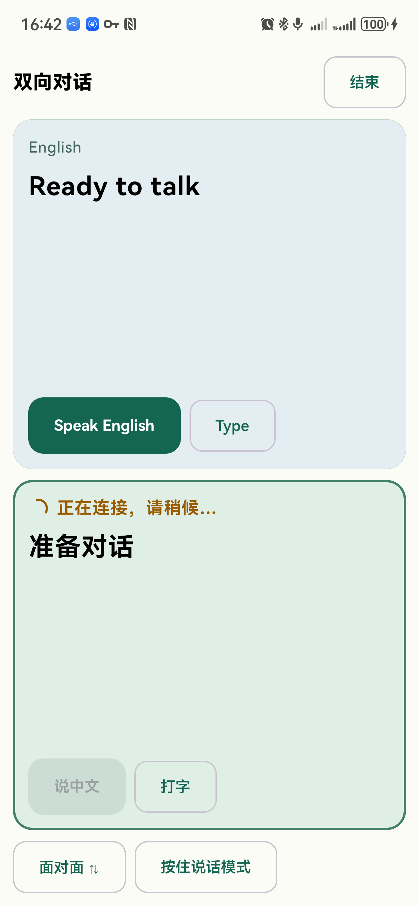
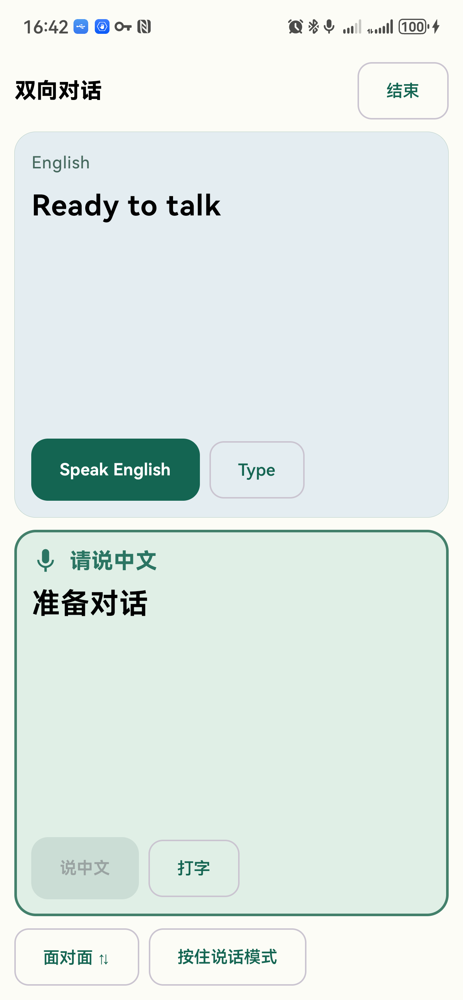
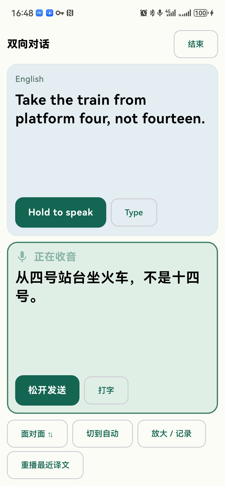
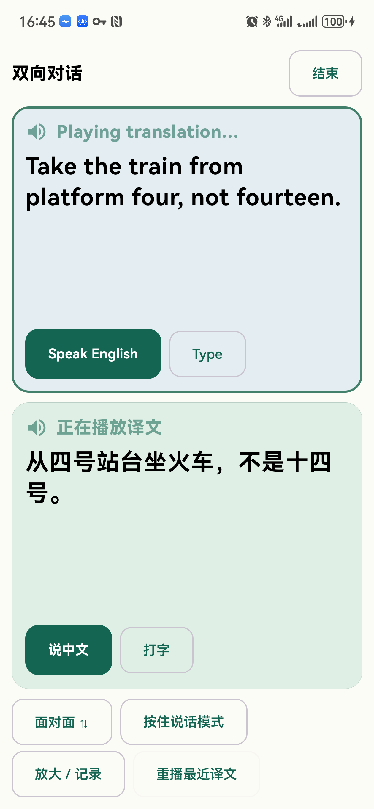
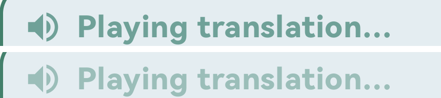
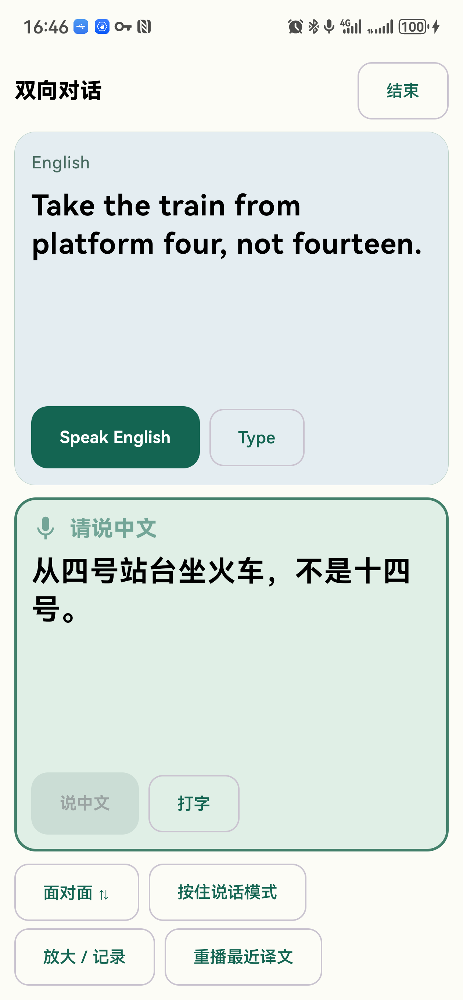
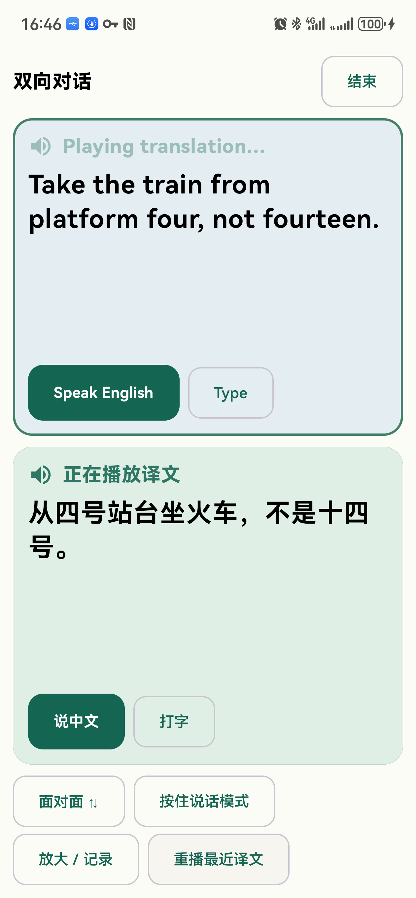
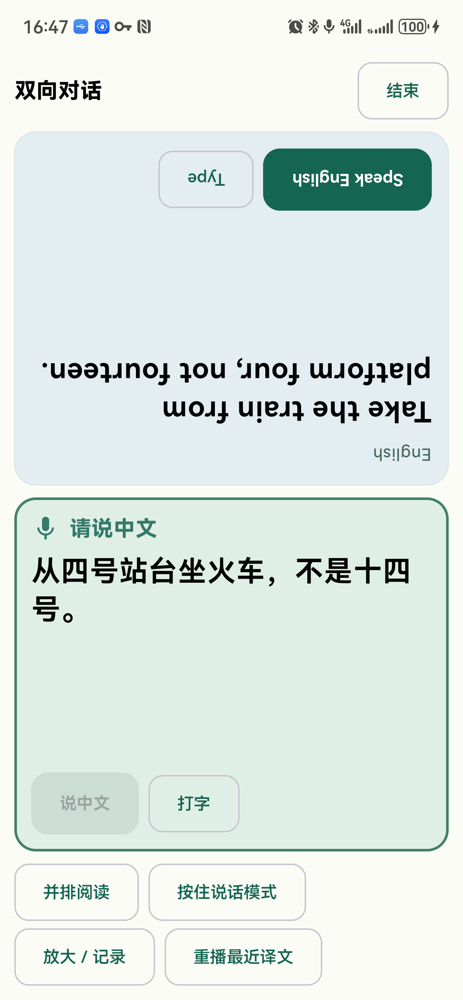
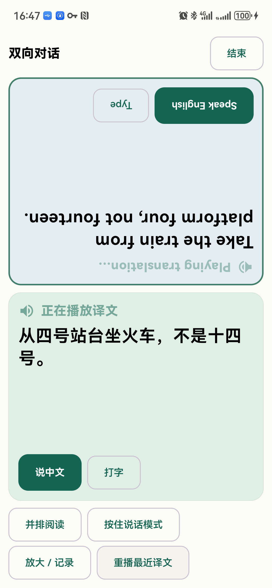

# 测试报告：会话页轮次提示增强

- 需求文档：../20261113-01-turn-cue-enhancement.md（v2）
- 测试日期：2026-11-13
- 测试环境：华为 ALN-AL80，Android 12（API 31）；App 1.0 debug 构建；模型 `gemini-3.8-live`；自动模式与按住说话模式
- 结论：通过

所有截图均为真机 `adb shell screencap` 原始截图。`TC02-pulse-compare.png`、`TC04-pulse-compare.png` 是从两张相隔约 0.3 秒的原始截图中裁出状态行后上下拼接，用来对比闪动前后的亮度。

## 测试用例

### TC01 连接中提示
- 对应验收标准：第 1 条
- 步骤：
  1. 强制停止 App 后重新打开。
  2. 点「开始对话」，立即截屏。
- 预期结果：中文一侧显示橙褐色"正在连接，请稍候…"和转动的加载圈，没有麦克风图标。
- 实际结果：中文一侧状态行为橙褐色加粗的"正在连接，请稍候…"，前面是橙褐色加载圈，没有麦克风图标。
- 结果：通过
- 证据：

### TC02 连接完成后的收音提示
- 对应验收标准：第 2 条
- 步骤：
  1. 接 TC01，等待约 3 秒连接完成。
  2. 间隔约 0.3 秒连续截两张图。
- 预期结果：同一侧变为绿色加粗"请说中文"，前面是麦克风图标，图标和文字一起闪动。
- 实际结果：
  - 状态行为绿色加粗 18sp 的"请说中文"，前面是绿色麦克风图标，加载圈消失。
  - 两张截图逐像素比较，差异只出现在状态行（图标和文字所在区域，坐标 x 101–426、y 1493–1556），说明图标和文字整体在变化，其他区域不变。
  - 两张图恰好截在亮度接近的时刻，肉眼差别不明显；更明显的暗帧见 TC03 和 TC05。
- 结果：通过
- 证据：
  - 
  - 
  - 

### TC03 按住说话时的收音提示
- 对应验收标准：第 3 条
- 步骤：
  1. 切到「按住说话模式」。
  2. 长按中文一侧的「按住说话」4 秒，按住期间截屏。
- 预期结果：显示麦克风图标和"正在收音"，一起闪动。
- 实际结果：中文一侧显示麦克风图标和"正在收音"，按钮变为"松开发送"；截图截在闪动的暗帧，图标和文字同时变淡。
- 结果：通过
- 证据：

### TC04 播放译文提示
- 对应验收标准：第 4 条
- 步骤：
  1. 在英文一侧点「Type」，输入 "Take the train from platform four, not fourteen."，点「Send」。
  2. 两侧都出现播放提示时，间隔约 0.3 秒连续截两张图。
  3. 播放结束后再截一张。
- 预期结果：播放时两侧状态文字前都有喇叭图标，一起闪动；播放结束后图标消失。
- 实际结果：
  - 播放时英文一侧显示喇叭图标和"Playing translation…"，中文一侧显示喇叭图标和"正在播放译文"。
  - 两张截图对比，两侧状态行亮度明显不同，差异区域覆盖两侧状态行（y 414–1467）。
  - 播放结束后自动轮到中文一侧：英文一侧恢复为灰色"English"、无图标，中文一侧变为麦克风图标和"请说中文"。
  - 译文为"从四号站台坐火车，不是十四号。"，数字和否定都保留了。
- 结果：通过
- 证据：
  - 
  - 
  - 
  - 

### TC05 重播时的播放提示
- 对应验收标准：第 5 条
- 步骤：接 TC04，点「重播最近译文」，立即截屏。
- 预期结果：两侧显示喇叭图标和闪动效果。
- 实际结果：两侧都显示喇叭图标和播放文字；截图中英文一侧处于暗帧、中文一侧处于亮帧附近，可见闪动。重播结束后回到中文一侧"请说中文"。
- 结果：通过
- 证据：

### TC06 面对面模式
- 对应验收标准：第 6 条
- 步骤：
  1. 点「面对面 ⇅」，截屏。
  2. 点「重播最近译文」，截屏。
- 预期结果：图标和文字随对方区域一起旋转 180°，显示正常。
- 实际结果：
  - 英文一侧整体旋转 180°；中文一侧保持正向，麦克风图标和"请说中文"正常。
  - 重播时，英文一侧的喇叭图标和"Playing translation…"随区域一起倒置显示，没有错位或截断。
- 结果：通过
- 证据：
  - 
  - 

## 未覆盖项

- 闪动是连续动画，截图只能证明不同时刻亮度不同，无法完整展示约 0.6 秒的呼吸节奏。
- 播放提示是用打字输入触发的翻译和播报测试的；语音输入走的是同一套播放提示代码，本次没有用语音输入单独测播放提示。

## 遗留问题

- "正在连接"依据的是"任一方向的连接还没建立"。如果只有对方方向在重连、当前方向已连好，当前一侧也会显示"正在连接"。本次测试没有遇到这种情况；如需按每个方向分别判断，需要改 `ConversationViewModel`，超出本次需求范围。
- TC03 按住说话时没有人说话，但模型把环境噪音翻译成了一句无关的中文（"就让他优先于我儿子。"）。这和本次界面改动无关，属于模型对噪音的处理问题。
